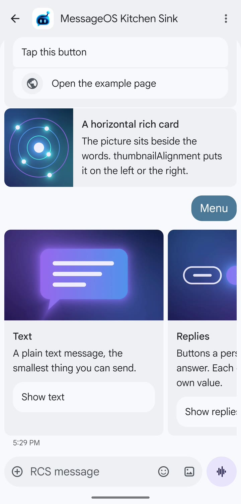
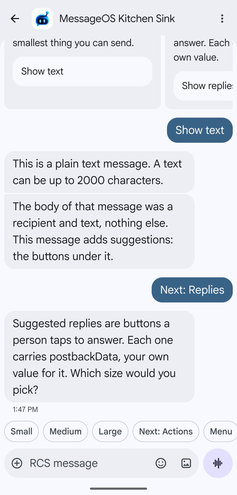
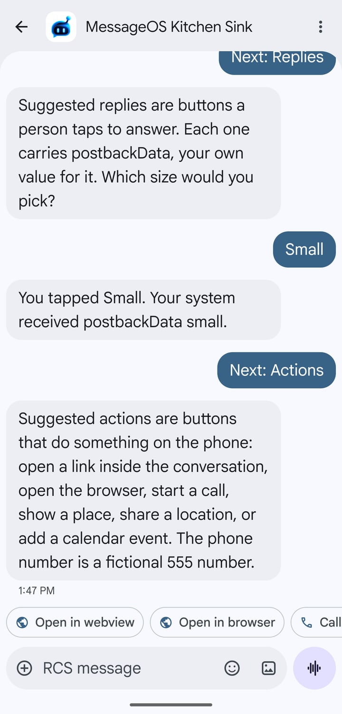
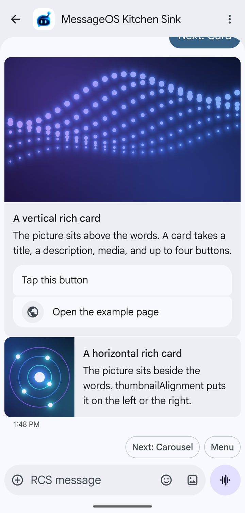
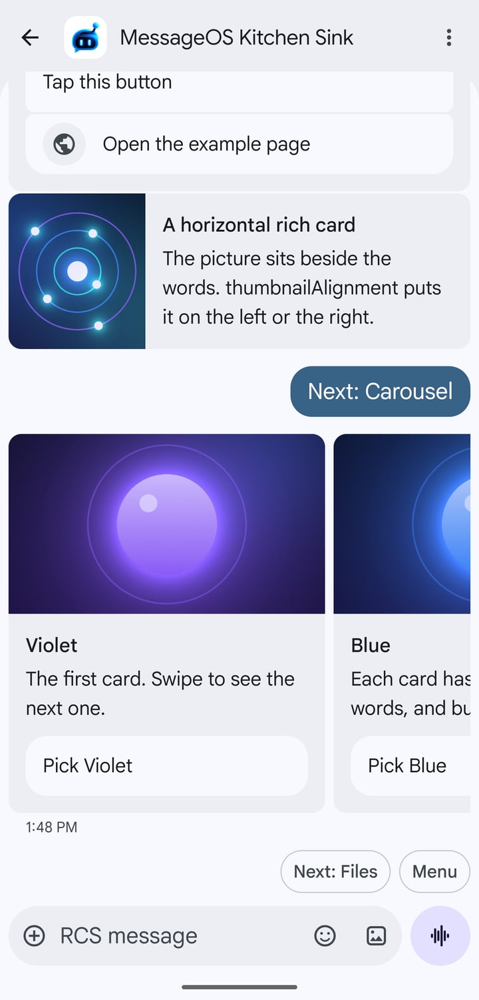
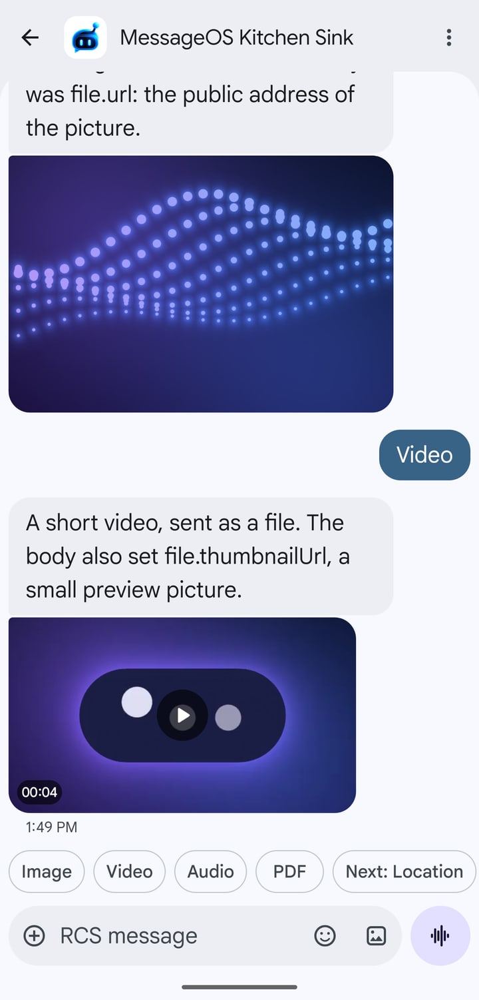
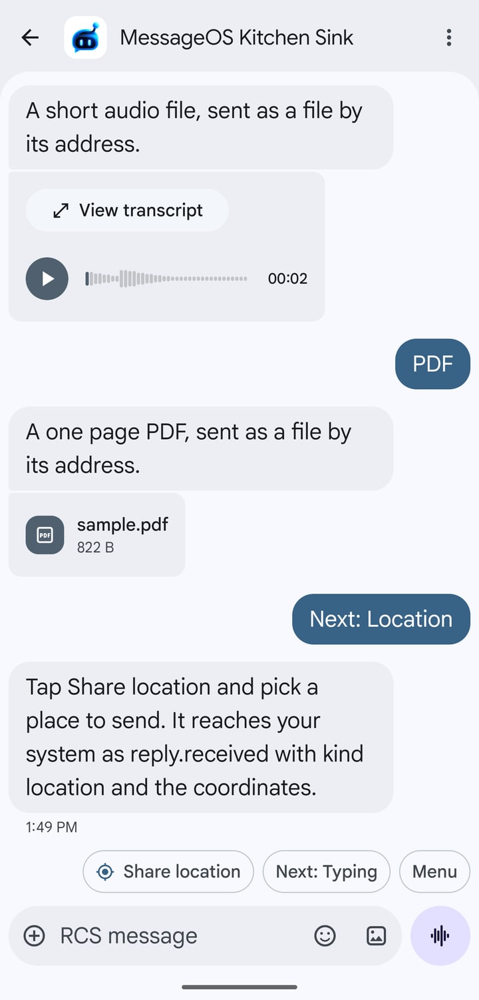
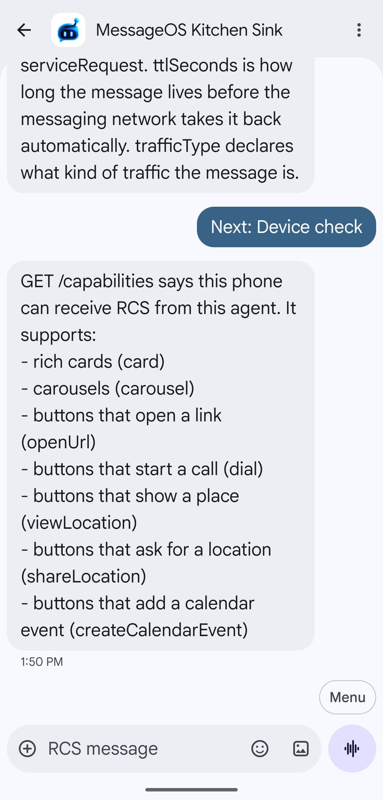

# MessageOS Kitchen Sink

An example app for a business whose own system answers its customers through the MessageOS API. It receives each message a person sends as a webhook event, and answers with `POST /v1/messages`. Along the way it shows every kind of message the API can send.

It is one small Node server with no runtime dependencies: `node:http`, `node:crypto`, and the built-in `fetch`. Read it, run it against your own key, and copy what you need.

## What it looks like

These are screenshots from a phone in a conversation with the Kitchen Sink agent. Under each one is the field or the call behind it. Click one to watch a short clip of that part of the conversation.

<table>
  <tr>
    <td align="center" valign="top" width="25%">
      <a href="clips/menu.mp4"></a><br>
      <b>Menu</b><br>
      <code>carousel</code>
    </td>
    <td align="center" valign="top" width="25%">
      <a href="clips/replies.mp4"></a><br>
      <b>Text and replies</b><br>
      <code>suggestions</code>
    </td>
    <td align="center" valign="top" width="25%">
      <a href="clips/actions.mp4"></a><br>
      <b>A tap, then actions</b><br>
      <code>postbackData</code>
    </td>
    <td align="center" valign="top" width="25%">
      <a href="clips/cards.mp4"></a><br>
      <b>Rich cards</b><br>
      <code>card</code>
    </td>
  </tr>
</table>

<table>
  <tr>
    <td align="center" valign="top" width="25%">
      <a href="clips/carousel.mp4"></a><br>
      <b>Carousel</b><br>
      <code>carousel</code>
    </td>
    <td align="center" valign="top" width="25%">
      <a href="clips/files-image-video.mp4"></a><br>
      <b>Image and video</b><br>
      <code>file.url</code>
    </td>
    <td align="center" valign="top" width="25%">
      <a href="clips/files-audio-pdf.mp4"></a><br>
      <b>Audio, PDF, location</b><br>
      <code>shareLocation</code>
    </td>
    <td align="center" valign="top" width="25%">
      <a href="clips/expiry-device.mp4"></a><br>
      <b>Device check</b><br>
      <code>GET /capabilities</code>
    </td>
  </tr>
</table>

There are also clips of [the Text demo](clips/text.mp4) and [the typing indicator](clips/typing.mp4).

The [Kitchen Sink showcase](https://docs.messageos.ai/docs/guides/kitchen-sink) in the MessageOS docs has every screenshot with what it shows, and a card for each thing the app can do.

## Documentation

The MessageOS docs explain everything this app does. They ask for a passcode, which MessageOS gives you.

| Page | What is in it |
| --- | --- |
| [Kitchen Sink showcase](https://docs.messageos.ai/docs/guides/kitchen-sink) | This app on a phone, and everything it can do |
| [Quickstart](https://docs.messageos.ai/docs/guides/quickstart) | A key, a first message in one call, then the reply |
| [When your own system answers](https://docs.messageos.ai/docs/guides/api-only) | The whole loop this app follows, with a checklist of what must be on |
| [The example app](https://docs.messageos.ai/docs/guides/example-app) | How to run this app, and its receiver in one file |
| [Webhooks](https://docs.messageos.ai/docs/guides/webhooks) | Every event, the retries, and a complete receiver in seven languages |
| [Message types](https://docs.messageos.ai/docs/guides/message-types) | A request body for each kind of message |
| [API reference](https://docs.messageos.ai/docs/api) | Every endpoint, with each request in eight languages |

## What it shows

Text your agent, and the app answers with a menu. Each card on the menu runs one demo. Every demo ends with two buttons, `Next: <name>` and `Menu`, so you can walk all ten in order. The last demo ends with `Menu` alone.

| Demo | What arrives on the phone | The API call behind it |
| --- | --- | --- |
| Menu | A carousel with one card for each demo | `POST /messages` with `carousel` |
| Text | A plain text message | `POST /messages` with `text` |
| Replies | Text with buttons to tap as an answer | `text` and `suggestions` of type `reply`, each with its own `postbackData` |
| Actions | Text with a button for every action | `suggestions` of type `openUrl` (webview and browser), `dial`, `viewLocation`, `shareLocation`, `createCalendarEvent` |
| Card | A vertical rich card, then a horizontal one | `card` with `media`, `title`, `description`, `suggestions`, `orientation`, `thumbnailAlignment` |
| Carousel | Three cards to swipe, each with its own button | `carousel` with `cards` |
| Files | An image, a video, an audio file, or a PDF | `file.url`, and `file.thumbnailUrl` for the video |
| Location | A button that asks for a location | A `shareLocation` suggestion. The answer arrives as `reply.received` with `location` |
| Typing | The typing indicator, then a message | `POST /typing`, a two second pause, `POST /messages` |
| Expiry | A text that expires, with a declared traffic type | `ttlSeconds` and `trafficType` |
| Device check | A short list of what this phone supports | `GET /capabilities` |

It also answers what a person sends on their own. The app checks these from top to bottom and takes the first that fits:

| The person | What the app reads in `reply.received` | The app |
| --- | --- | --- |
| Types STOP, START, HELP, or another keyword, alone or with a file | `text` | Nothing. MessageOS answers these itself |
| Sends a photo or a file, with or without a caption | `attachments` is not empty | Says what arrived, from the event alone: the media type, the file name, and the caption if there is one. It does not download the file |
| Shares a location, with or without words | `location` is not null | Answers with the coordinates, any words sent with them, and a `View on map` button for the same point |
| Taps a suggested reply | `kind` is `chip`, with your `postbackData` | Answers `You tapped <label>. Your system received postbackData <value>.`, where `<value>` is the part after `ks:picked:` |
| Taps an action | `kind` is `chip` | Nothing. The action already did its work on the phone |
| Taps a button this app no longer knows | `kind` is `chip`, with a `postbackData` the app does not have | Sends the menu. A button on a card stays in the conversation for good, so an old one can be tapped long after |
| Types `menu`, `hi`, `hello`, or `hey` | `text` | Sends the menu |
| Types the name of a demo, such as `card` | `text` | Runs that demo |
| Types anything else | `text` | Answers `You said: <their text>` |

The order matters because of what `kind` says. It is `chip` for a tap. Otherwise it is `text` when the message has words, `file` when a file came with no words, and `location` when a place came with no words. So a photo sent with a caption has kind `text`, and so does a place sent with words. An app that looks only at `kind` would answer the caption and miss the photo. This app looks at `attachments` and `location` first, and at `kind` only to tell a tap from typed words. The code is `routeReply` in `src/conversation.js`.

Every button this app makes carries a `postbackData` that starts with `ks:`, and the app routes on that value, never on the label: `ks:menu`, `ks:<demo id>`, `ks:picked:<value>`, `ks:file:image`, `ks:action:<type>`.

No answer leaves a person with nothing to tap. Buttons show only under the newest message, so the last message of every answer carries at least the `Menu` button: the echo, the answer to a file or a location, each sample file, and each line that says a feature is not turned on. The menu is the one exception: each of its cards has its own button.

## Five-minute setup

You need three things:

- Node 20 or newer.
- A MessageOS client key. An owner or admin of your brand makes one in the MessageOS dashboard, under Developers, with these permissions: `messages:write`, `contacts:read`, `contacts:write`, `conversations:read`, `webhooks:manage`, `usage:read`. The key starts with `mosc_` and is shown once.
- A phone the agent can reach. Until your agent is launched, it reaches only the phones MessageOS has added as its testers.

This app answers every message itself, so the MessageOS assistant must not answer too, or the person gets two replies. Ask MessageOS to set your agent to API only, or pause the assistant on the Agent page of the dashboard.

The app has five settings. You bring the key. The steps below give you the other two that have no default.

| Setting | Where it comes from |
| --- | --- |
| `MESSAGEOS_API_KEY` | You, from the dashboard. Step 2 |
| `PUBLIC_URL` | You: the public https address of your tunnel or your host, with no path. Step 4 |
| `MESSAGEOS_WEBHOOK_SECRET` | `npm run setup:webhook` prints it once, when it makes the webhook. Step 6 |
| `MESSAGEOS_API_URL` | Already set in `.env.example` to `https://api.messageos.ai/v1`. Change it only if MessageOS gave you another address |
| `PORT` | Already set to 3000. Change it only if that port is taken |

1. Install. The app itself needs no packages. These are two tools that check the code.

   ```bash
   npm install
   ```

2. Copy `.env.example` to `.env`, and put your key in `MESSAGEOS_API_KEY`. Git ignores `.env`.

   ```bash
   cp .env.example .env
   ```

3. Check the key. This calls `GET /whoami` and prints what your key can use, any permission it lacks, and which demos will run.

   ```bash
   npm run check
   ```

4. Give the app a public https address, and put it in `PUBLIC_URL` with no path and no slash at the end. MessageOS delivers events only to a public https address, and the phone network fetches the pictures and files from the same address. On your own computer, run a public https tunnel that forwards to port 3000, and use the address the tunnel gives you.

5. Start the app, then open `<PUBLIC_URL>/health` in a browser. It answers `{ "ok": true }` with which settings are present, as true or false, and never shows a value. If the page does not load, the public address does not reach the app yet. At this point `webhookSecret` is false.

   ```bash
   npm start
   ```

6. In a second terminal, register the webhook. This calls `POST /webhooks` for `<PUBLIC_URL>/webhooks/messageos` and prints the signing secret once. Put it in `MESSAGEOS_WEBHOOK_SECRET`, then stop the app and start it again. Until then the app refuses every event, because it cannot check a signature.

   ```bash
   npm run setup:webhook
   ```

   If you add the webhook in the dashboard instead, under Developers, give it the same address and the events `reply.received`, `message.delivered`, `message.read`, `message.failed`, `contact.opted_out`, and `contact.opted_in`. The dashboard shows the signing secret once, right after you add it.

7. Start the conversation. This sends the menu to your own phone, as a message you start. Put your own number in place of the sample one, in E.164 form: a plus sign, the country code, and the number.

   ```bash
   npm run send:menu -- +15555550123
   ```

   Tap a card. Each tap arrives at the app as `reply.received`, and the app answers. If you already have a conversation with your agent on the phone, typing `menu` there does the same.

The scripts and `npm start` read `.env` themselves on Node 20.12 or newer. On an older Node 20, set the same names in your shell before you run them.

If nothing arrives on the phone, read the app's own output first. It writes one line for each event it receives and each message it sends, with the status the API answered and why a message was not sent.

## How the receiver works

The receiver is `POST /webhooks/messageos`, in `src/app.js`. It follows five rules, in this order, and each one is marked in the code.

1. **Read the raw body.** The signature covers the exact bytes MessageOS sent. A body that was parsed and encoded again can differ in spacing or key order, and the signature then fails. The app collects the bytes with `data` and `end` listeners on the request. A host that runs functions can read the body before the handler runs, to offer a parsed `req.body`, and then hand the bytes back through those two events only, so a `for await` loop over the request finds an empty body there and every signature fails. Where a host keeps the bytes as `req.rawBody` instead, the app uses that.
2. **Check the signature in constant time.** `x-messageos-signature` is `sha256=` and the lowercase hex HMAC-SHA256 of `<x-messageos-timestamp>.<raw body>`, keyed with the webhook's signing secret. `src/signature.js` computes it and compares with `timingSafeEqual`. A request that fails is answered 401 and nothing is done with it.
3. **Refuse a timestamp more than 300 seconds off.** This stops a captured request from being played back later. Each delivery attempt is signed again with a new timestamp, so a real retry always passes.
4. **Never act twice on one event.** A delivery can arrive more than once. The app remembers the ids of the events it has handled, but that memory lives in one process: a second server, a restart, or a host that runs functions has not seen the event. So the real guard is on every send. Each message goes out with the header `Idempotency-Key: ks-reply-<inboundMessageId>-<n>`, where `inboundMessageId` is the id of the person's message, from the event's `data`, and `n` is the position of the message in the answer. The key is built from the message and not from the event id, because each webhook endpoint gets its own copy of an event with its own id. With two endpoints that both take `reply.received`, such as an old and a new address during a move, a key built from the event id would answer every message twice. When the same message is handled again, anywhere, the same keys go out with the same bodies, MessageOS returns the answers it stored, and the person gets nothing twice.
5. **Answer 2xx only when the work is done.** The app sends its messages first and answers 200 after. If the API cannot take a send right now, the app answers 500, MessageOS delivers the event again later, and rule 4 makes that repeat safe: the messages that went out are replayed from the stored answers, and the rest are sent. MessageOS waits 10 seconds for the answer. A later answer counts as a failed attempt, and the event is delivered again, the first time after 30 seconds, which the keys make safe. So keep the work in the request short, and move anything slow out of it. The answers here hold a pause on purpose, 1.5 seconds between two messages and 2 seconds in the typing demo, so each takes a few seconds, well inside that limit while the API answers quickly.

Because of rule 4, an answer must be the same every time it is built for one message. Nothing in a message body comes from the clock, from a random value, or from the event's `id` or `createdAt`, which differ between two copies of one event. The calendar event in the Actions demo, for example, is dated from `receivedAt`, the time the person's message was received.

Not every failed send is worth another delivery. A send that MessageOS blocks, for example because the person opted out, will be blocked again, so the app logs the reason and accepts the event. A key that is refused (401 or 403) does ask for another delivery, so once the key is fixed the waiting events are answered.

Events do not wait forever. By default an event is tried 8 times over about an hour, with waits that double from 30 seconds to 32 minutes, and is then marked dead. When the 8 newest deliveries to a webhook are all dead, the webhook is paused. A paused webhook is sent nothing, and an event that happens during the pause is not delivered later. So after you fix a key, or anything else that made the app answer 500 for a long time (no `MESSAGEOS_API_KEY`, or a `PUBLIC_URL` that is not https), look at the webhook. If it is paused, set its status back to active: `PATCH /webhooks/{id}` with the body `{ "status": "active" }`, or the dashboard under Developers. `npm run setup:webhook` says so when it finds the webhook paused.

Other events: `message.delivered`, `message.read`, `message.failed`, `contact.opted_out`, and `contact.opted_in` each write one log line, where a real system would update its own records. `webhook.test` and any type the app does not know are accepted with 200.

## How replies and the one-hour window work

Every answer names the person's message in `inReplyTo`. The value is `inboundMessageId` from the `reply.received` event.

```json
{ "to": { "contactId": 42 }, "text": "You said: What time do you open?", "inReplyTo": 981, "reference": "kitchen-sink:echo" }
```

- A send that names a message from the last hour is a reply. A reply needs no consent record, and quiet hours do not hold it. `GET /whoami` shows the window as `replyWindowSeconds`.
- Up to three sends can answer one message this way. That is why no demo sends more than three messages. Each new message from the person allows three more.
- A fourth send, a send that names an older message, or a promotional send is treated like any message you start.
- A person who opted out is never sent anything, reply or not.
- Where `replyWindowSeconds` is null, replies are not turned on and a body with `inReplyTo` returns 422. The app reads that from `GET /whoami` and leaves the field out.

`npm run send:menu` is the other case: a message you start. It is not a reply, so it carries `consent`, your record of where and when the person agreed to get messages. With a phone number that is not yet a contact, the contact is created with that record in the same call.

Buttons show only under the newest message in a conversation. So in an answer of two messages the buttons go on the last one, and the app waits a moment between the two, because a card or a file can take longer to appear than text sent right behind it.

`reference` is your own id for a message. The app sets it to the name of the demo, and it comes back in `message.delivered`, `message.read`, and `message.failed`, so the log shows which message each report is about.

## What MessageOS does for you

- **Keywords.** STOP, START, HELP, and the other consent keywords are answered by MessageOS, whatever your system does. It records the opt out or opt in and sends the confirmation. Your webhook still receives each one as `reply.received`, so your system must know the list and stay silent. It is in `src/keywords.js`. The change itself arrives as `contact.opted_out` or `contact.opted_in`.
- **Read receipts.** Each message from a person who has not opted out is marked read when it arrives. There is no call to make.
- **Opt outs.** A send to a person who opted out returns 409 with the reason `opted_out`. You do not have to keep the list yourself.
- **Delivery reports.** Each message you send is reported as delivered, read, or failed, with the `id` the send answered with and your `reference`.

## Adapting to your key

MessageOS turns features on for each API address. `GET /whoami` says which you have, and the app reads it before it answers (and remembers it for five minutes):

| `GET /whoami` | When it is off |
| --- | --- |
| `richMessages` false | Buttons, cards, carousels, and files return 422. The menu is sent as text, the demos made of them say they are skipped, and the rest run with typed commands. With no buttons to tap, each answer ends with what to type next |
| `rcsExtras` false | `POST /typing` and `GET /capabilities` return 404, and `ttlSeconds` and `trafficType` return 422. Those three demos say so in one line |
| `replyWindowSeconds` null | `inReplyTo` returns 422. Answers are sent without it |

## Scripts

| Command | What it does |
| --- | --- |
| `npm start` | Runs the server on `PORT` |
| `npm run dev` | The same, restarting when a file changes |
| `npm run check` | Calls `GET /whoami` and prints what the key and the API address offer |
| `npm run setup:webhook` | Registers the webhook for `PUBLIC_URL` and prints its secret once, or says one already exists and whether it is paused |
| `npm run send:menu -- <number>` | Sends the menu to one phone number in E.164, with a consent record |
| `npm run typecheck` | Checks the JavaScript against its JSDoc types |
| `npm test` | Runs the tests |

The tests need no network and no key. They start the real handler and a stand-in for the MessageOS API on free local ports, post signed events, and check every call the app makes: good and bad signatures, an old timestamp, a host that reads the body first, a redelivered event, every demo, a photo with a caption, a place with words, keyword silence, each feature turned off, a tap on a button the app no longer knows, and that every answer ends with the `Menu` button, or is the menu.

## Deploying

The app is one handler, `(req, res)`, exported from `src/app.js`.

- **Any host that runs a Node server.** Run `npm start` with the settings in the environment. `PORT` is the port to listen on, and many hosts set it for you.
- **A host that runs functions.** `api/index.js` exports the same handler, and `vercel.json` sends every path to it. The host serves the files in `public/` itself, so `/media/...` never reaches the function. Set the settings in the host's own environment settings, not in a file. Such a host can read the request body before the handler runs. The receiver still gets the exact bytes, as rule 1 above explains, so there is nothing to turn off.

Either way, `PUBLIC_URL` must be the address the app is reached at, and the webhook must be registered for `<PUBLIC_URL>/webhooks/messageos`. A new address needs a new webhook.

Keep `MESSAGEOS_API_KEY` and `MESSAGEOS_WEBHOOK_SECRET` out of git and out of your logs. The app never logs either one, and it does not log what a person wrote.

## File map

| Path | What is in it |
| --- | --- |
| `src/app.js` | The handler: the webhook receiver, `/health`, `/`, and `/media/*` |
| `src/server.js` | Runs the handler with `http.createServer` |
| `api/index.js`, `vercel.json` | The same handler as a function |
| `src/signature.js` | The signature and timestamp check |
| `src/conversation.js` | Which answer each message gets, read from what arrived, and how it is sent: `inReplyTo`, the Idempotency-Key, at most three messages |
| `src/content.js` | The body of every message, as plain data |
| `src/keywords.js` | The words MessageOS answers itself |
| `src/messageos.js` | A small client for the API calls the app makes |
| `src/config.js`, `.env.example` | The settings, and a file to copy with a comment on each |
| `src/types.js` | The shapes of an event and of a message body, as JSDoc types |
| `tour.json` | The demos in tour order: id, name, menu button, and the demo after it |
| `public/media/` | The sample pictures, video, audio file, and PDF. They were made for this example and you may replace them |
| `screenshots/` | The phone screenshots in this file. The app does not read or serve them |
| `clips/` | Short clips of the same conversation, which the pictures in this file open. The app does not read or serve them |
| `scripts/` | `check`, `setup:webhook`, and `send:menu` |
| `test/`, `test-support/` | The tests, the stand-in API, and the request rules the tests check each body against |
| `AGENTS.md` | The rules of this example, written for a coding assistant that works in it |
